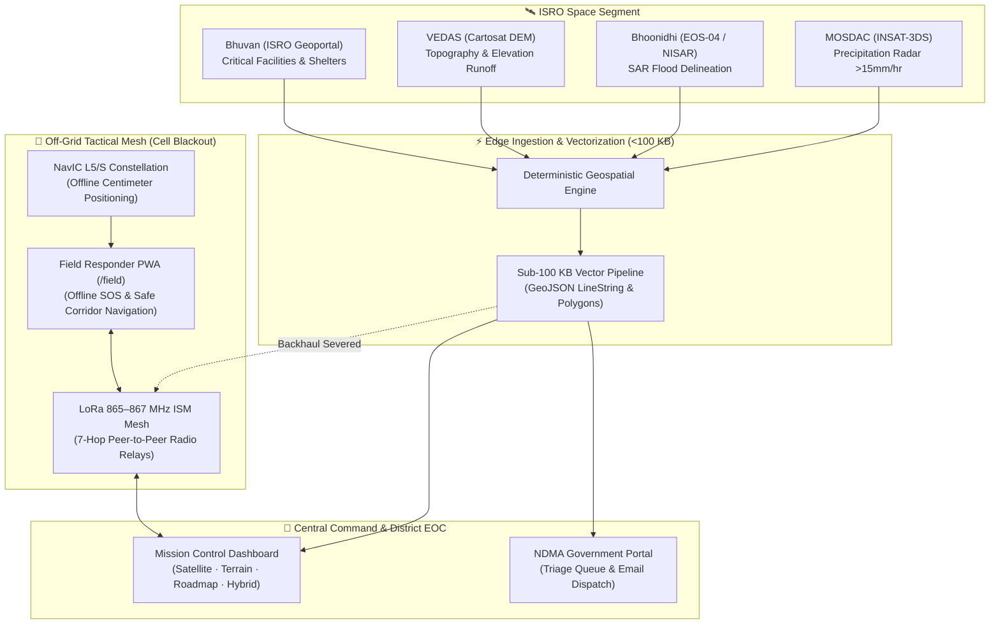

# 🛰️ TerraPulse Astra — Space-to-Ground Disaster Intelligence & Tactical Mesh

> **Monitor • Analyse • Act**  
> AI-powered ISRO Earth Observation flood intelligence and off-grid tactical rescue platform.  
> **Live Production URL:** [https://terrapulse-astra.vercel.app/](https://terrapulse-astra.vercel.app/)  
> **Hackathon Demo Video:** [`terrapulse_hackathon_demo.mp4`](./terrapulse_hackathon_demo.mp4) (1080p Full HD)

[](https://vercel.com/new/clone?repository-url=https%3A%2F%2Fgithub.com%2FHimanshusaurabh0411%2FAstra&root-directory=frontend)
[](https://nextjs.org/)
[](https://fastapi.tiangolo.com/)
[](https://www.isro.gov.in/)
[](https://terrapulse-astra.vercel.app/field)

---

## ⚡ 1-Click Vercel Deployment & Live Demo

- **Live Production Web App:** [https://terrapulse-astra.vercel.app/](https://terrapulse-astra.vercel.app/)
- **Field Responder PWA:** [https://terrapulse-astra.vercel.app/field](https://terrapulse-astra.vercel.app/field)
- **Government Command Portal:** [https://terrapulse-astra.vercel.app/government](https://terrapulse-astra.vercel.app/government)
- **India Weather Workspace:** [https://terrapulse-astra.vercel.app/weather](https://terrapulse-astra.vercel.app/weather)
- **Agromet Farm Planner:** [https://terrapulse-astra.vercel.app/farm](https://terrapulse-astra.vercel.app/farm)

To deploy your own instance to Vercel:
1. Click the **[Deploy with Vercel](https://vercel.com/new/clone?repository-url=https%3A%2F%2Fgithub.com%2FHimanshusaurabh0411%2FAstra&root-directory=frontend)** button above.
2. Select `frontend` as Root Directory, framework preset `Next.js`.
3. Deploy! The frontend includes self-contained offline GIS hydration (`src/lib/offlineStore.ts` & `src/lib/serverState.ts`) so all interactive maps, offline simulations, weather cards, and rescue workflows run 100% standalone out-of-the-box.

---

## 🌊 The Problem: The Silent Crisis in Disaster Response

Every monsoon, India faces two contrasting, high-stakes hydrological emergencies:
1. **The Assam Brahmaputra Macro-Flood:** Massive, slow-motion inundation submerging over 14,000 hectares across multiple revenue circles.
2. **The Wayanad Western Ghats Cloudburst:** Lightning-fast flash floods and catastrophic terrain slope landslides.

**The Fatal Failure Point:** When severe cloudbursts (>15 mm/hr) strike, power grids fail and cellular backhaul collapses within hours. District disaster collectors and first responders are left blind—stranded without map data, unable to transmit coordinates, and forced to navigate submerged roads.

**TerraPulse Astra** bridges this critical gap by fusing real-time ISRO satellite observation feeds with offline-first NavIC satellite positioning and peer-to-peer LoRa 865 MHz mesh networking.

---

## 🏛️ System Architecture: Space-to-Ground Cascade



---

## 🗺️ Key Features & Workspaces

### 1. Tactical Mission Control Dashboard (`/`)
- **4 Distinct Map Engines**:
  - **Satellite Engine**: Live Sentinel-2 / Landsat multispectral imagery cutting through cloud cover.
  - **Terrain Engine**: Cartosat DEM hypsometric tinting displaying major river drainages (Ganga, Brahmaputra, Narmada, Godavari, Krishna) and labeled mountain peaks.
  - **Roadmap Mode**: OpenStreetMap / Bharat Vector Network illuminating the Golden Quadrilateral (NH-48, NH-16, NH-19), North-South/East-West corridors (NH-44, NH-27), and 14 logistics hubs.
  - **Hybrid Mode**: High-contrast satellite imagery overlaid with highway vectors and tactical units.
- **One-Click Simulation Controls**:
  - `Simulate Heavy Rain`: Spikes precipitation past 35 mm/hr, submerges low-lying causeways.
  - `Simulate Network Blackout`: Disconnects cellular backhaul, shifts system status to `● Offline Mesh`, and activates 6 LoRa radio relay hops.
  - `Send Safe Route`: Dispatches a deterministic high-ground evacuation corridor and centers the map directly on the verified relief shelter.
  - `Reset`: Restores national baseline telemetry.
- **Interactive Triage Card**: Instant drill-down into Details, Impact (population at risk, submerged schools/roads), and Resources (NDRF boats, SDRF divers, IAF helicopters).

### 2. India Weather Workspace (`/weather`)
- Live meteorological observations across all 36 Indian states and Union Territories.
- Real-time temperatures, wind speeds, 24-hour precipitation forecasts, rain probabilities, and official IMD warnings links.

### 3. Agromet Farm Planner (`/farm`)
- 48-Hour Actionable Farm Windows based on IMD Agromet advisories:
  - **Irrigation Window**: Optimal watering timing based on forecasted rainfall.
  - **Spraying Window**: Safe pesticide application periods factoring in wind gust limits.
  - **Harvest & Drying Window**: Safe crop curing and field work periods.
- 5-Day daily outlook cards with high/low temperature ranges and precipitation trends.

### 4. Government NDMA Command Portal (`/government`)
- Dedicated portal for National and State Disaster Management Authorities.
- Real-time response queue tracking headcounts, medical needs, and rescue boat requirements.
- One-click Gmail drafts and instant incident resolution workflow.
- Live data source telemetry tracking ingested record counts across MOSDAC, Bhoonidhi, VEDAS, and Bhuvan.

### 5. Field Responder PWA (`/field`)
- Installable offline Progressive Web App for search and rescue personnel and trapped citizens.
- **Offline NavIC L5/S Positioning**: Centimeter-grade coordinate lock independent of cellular triangulation.
- **Offline SOS Queue**: Headcount counter, urgency selector (Critical / High / Moderate), and assistance tags.
- **LoRa Peer-to-Peer Mesh Visualizer**: Tracks packet propagation across multi-hop radio repeaters.
- **Safe Evacuation Corridors**: Displays turn-by-turn higher-ground evacuation routes to nearest vetted shelters.

---

## 🎬 2.5-Minute Hackathon Demo Script & Video

A full 1080p video walkthrough is generated and bundled in this repository:
- **Video File:** [`terrapulse_hackathon_demo.mp4`](./terrapulse_hackathon_demo.mp4) (Full HD, 24 fps, H.264)
- **Detailed Script & Storyboard:** See [`.agents/skills/demo-pitch/SKILL.md`](.agents/skills/demo-pitch/SKILL.md) and [`terrapulse_hackathon_demo_package.md`](terrapulse_hackathon_demo_package.md)

### Walkthrough Summary:
1. **0:00 – 0:25 | The Silent Crisis**: Problem statement covering Assam floods, Wayanad landslides, and cellular failure.
2. **0:25 – 0:55 | Assam Brahmaputra Flood**: Global search `Assam`, Sentinel-2 satellite layer, Cartosat DEM river gauge breaching danger mark.
3. **0:55 – 1:25 | Wayanad Western Ghats**: Mountain slope contours, landslide choke points, and 48-hour agromet advisory cards.
4. **1:25 – 1:45 | The "Aha!" Moment**: Triggering heavy rain & network blackout; switching to `/field` PWA with NavIC satellite lock.
5. **1:45 – 2:15 | LoRa Mesh & ISRO Architecture**: 865 MHz peer-to-peer radio hops, <100 KB vector payloads, NDMA government dispatch.
6. **2:15 – 2:30 | Closing Vision**: *"Monitor · Analyse · Act · Building a Safer, Smarter India."*

---

## 🛡️ Judge Defense & FAQ

<details>
<summary><b>1. How does TerraPulse guarantee zero AI hallucinations during life-and-death evacuations?</b></summary>
TerraPulse uses <b>deterministic Dijkstra/A* graph traversal over VEDAS Cartosat road networks</b> for evacuation corridors—never generative LLMs. Submerged road states and flood boundaries are computed mathematically from SAR backscatter drops (&lt;-16.5 dB) and river gauges. If a road is flooded, its graph edge weight becomes infinite, guaranteeing an AI never routes citizens into deep water.
</details>

<details>
<summary><b>2. What happens if all mobile cellular towers collapse?</b></summary>
The entire regional GIS slice is cached locally in browser IndexedDB. Field responders utilize India’s indigenous <b>NavIC L5/S satellite constellation</b> for positioning. Distress packets route across unlicensed <b>865–867 MHz LoRa mesh repeaters (up to 7 hops)</b> without cellular data. When any responder touches an operational backhaul or satellite terminal, all queued packets automatically synchronize.
</details>

<details>
<summary><b>3. Why not just use Google Maps or MapmyIndia?</b></summary>
Civilian navigation apps have no awareness of hydrological gauges, radar cloudburst intensity, or SAR soil backscatter, and regularly direct civilian traffic through submerged low-lying causeways. TerraPulse dynamically closes flooded crossings and illuminates verified high-ridge corridors to verified shelter points.
</details>

<details>
<summary><b>4. How does the system handle low bandwidth in rural disaster areas?</b></summary>
Traditional GIS systems stream heavy multi-megabyte GeoTIFF raster tiles. TerraPulse vectorizes all flood zones, road passability, and emergency pins into compact GeoJSON payloads under <b>100 kilobytes</b>—transmissible over narrowband LoRa packets or 2G connections in under 800 milliseconds.
</details>

---

## 🚀 Quickstart & Local Development

### Prerequisites
- Node.js 20+ / 22+
- Python 3.11+
- Git

### 1. Run with Docker Compose
```bash
docker compose up --build -d
docker compose ps
```
Open [http://localhost:3000](http://localhost:3000) for the Mission Control Dashboard or [http://localhost:3000/field](http://localhost:3000/field) for Field Responder.

### 2. Manual Local Development

**Backend (FastAPI):**
```bash
cd backend
python3 -m venv .venv
source .venv/bin/activate
pip install -r requirements.txt
python -m uvicorn app.main:app --host 0.0.0.0 --port 8000 --reload
```

**Frontend (Next.js 14):**
```bash
cd frontend
npm install
npm run dev
```

### 3. Verification & Type Checks
```bash
cd frontend
npx tsc --noEmit
npm run build
```

---

## 📄 License & Attribution
- Built for the Antigravity Hackathon 2026.
- Satellite data sourced from ISRO open data repositories: **MOSDAC**, **Bhoonidhi**, **VEDAS**, and **Bhuvan**.
- Topographic basemaps utilize NASA Blue Marble and Natural Earth Data.
- Licensed under the Apache 2.0 License.
